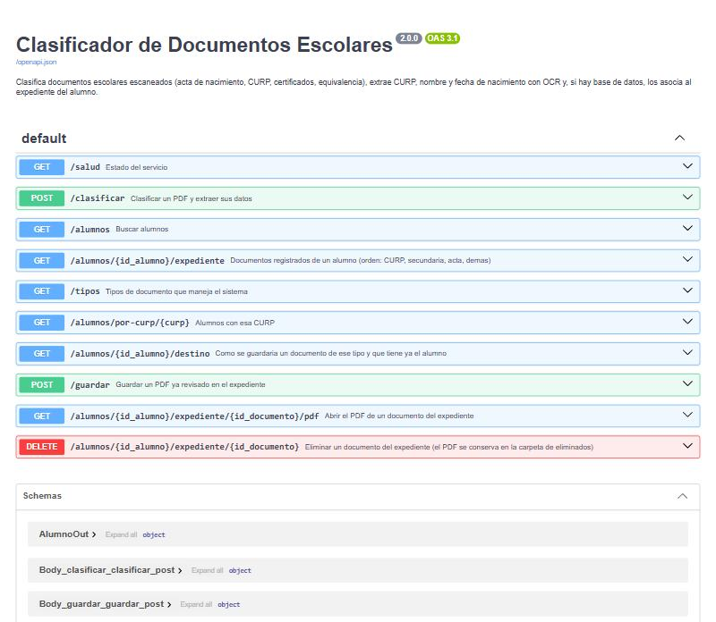
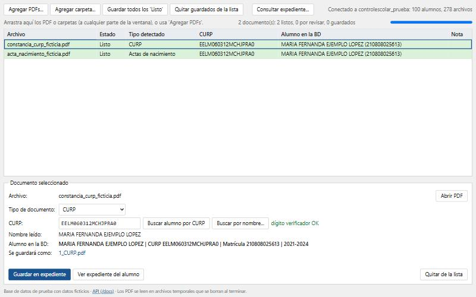
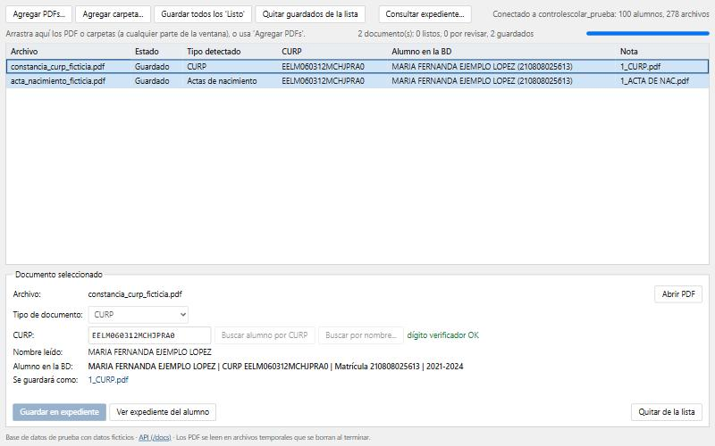
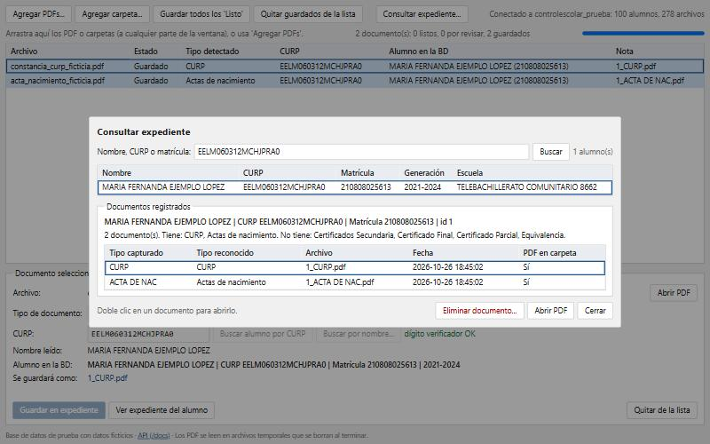

# Evidencia de integración — API y endpoints (Fase II)

Este documento muestra, con **peticiones y respuestas reales**, cómo se integran los componentes del sistema:
la interfaz web, la API REST (FastAPI), el modelo de clasificación con OCR, la base de datos MySQL y el almacenamiento de PDFs.

Todas las salidas se obtuvieron ejecutando el sistema con `docker compose up --build` el 26 de octubre de 2026, con datos ficticios.

## 1. Componentes que se integran

| Componente | Tecnología | Cómo se comunica |
|---|---|---|
| Interfaz web | HTML + JavaScript (`app/static/index.html`) | Llama a la API con `fetch` (HTTP/JSON y multipart) |
| API REST | FastAPI + Uvicorn (`app/main.py`) | Recibe PDFs y devuelve JSON |
| Lectura de documentos | Poppler (PDF a imagen) + Tesseract OCR | Se invoca desde la API en el mismo contenedor |
| Clasificador de tipo | TF-IDF + LinearSVC (scikit-learn) | Se carga una sola vez al arrancar |
| Base de datos | MySQL 8.0 (contenedor `db`) | La API usa PyMySQL con consultas parametrizadas |
| Archivos de alumnos | Carpeta `expedientes/` (volumen del contenedor) | La API escribe `<idAlumno>_<TIPO>.pdf` |

La documentación interactiva de la API se genera sola y está disponible en `/docs` (Swagger UI) y `/openapi.json`:



## 2. Endpoints

| Método | Ruta | Para qué |
|---|---|---|
| GET | `/salud` | Estado del servicio, del modelo y de la base de datos |
| GET | `/tipos` | Tipos de documento que maneja el sistema |
| POST | `/clasificar` | Lee un PDF: tipo, CURP, nombre, fecha y alumno encontrado |
| GET | `/alumnos?q=...` | Busca alumnos por nombre, CURP o matrícula |
| GET | `/alumnos/por-curp/{curp}` | Alumno(s) con esa CURP |
| GET | `/alumnos/{id}/destino?categoria=...` | Con qué nombre se guardaría el archivo y qué tiene ya el alumno |
| POST | `/guardar` | Guarda un PDF revisado (`nuevo`, `reemplazar` o `adicional`) |
| GET | `/alumnos/{id}/expediente` | Documentos del alumno |
| GET | `/alumnos/{id}/expediente/{doc}/pdf` | Abre el PDF de un documento |
| DELETE | `/alumnos/{id}/expediente/{doc}` | Elimina el documento (el PDF se conserva en `archivos_eliminados`) |

## 3. Ejemplos reales de cada endpoint

### 3.1 Estado del servicio — `GET /salud`

```bash
curl http://localhost:8000/salud
```

```json
{
    "estado": "ok",
    "modelo_cargado": true,
    "base_datos": "conectada",
    "categorias": [
        "Actas de nacimiento",
        "CURP",
        "Certificado Final",
        "Certificado Parcial",
        "Certificados Secundaria",
        "Equivalencia"
    ],
    "base_nombre": "controlescolar_prueba",
    "alumnos": 100,
    "archivos": 278,
    "documentos_procesados": 1,
    "segundos_activo": 55
}
```

Con esto se comprueba que el contenedor `api` cargó el modelo y que se comunica con el contenedor `db`.

### 3.2 Tipos de documento — `GET /tipos`

```json
[
    {
        "categoria": "CURP",
        "tipo_bd": "CURP"
    },
    {
        "categoria": "Certificados Secundaria",
        "tipo_bd": "CERT DE SEC"
    },
    {
        "categoria": "Actas de nacimiento",
        "tipo_bd": "ACTA DE NAC"
    },
    {
        "categoria": "Certificado Final",
        "tipo_bd": "CERT FINAL"
    },
    {
        "categoria": "Certificado Parcial",
        "tipo_bd": "CERT PARCIAL"
    },
    {
        "categoria": "Equivalencia",
        "tipo_bd": "EQUIVALENCIA"
    }
]
```

### 3.3 Clasificar un PDF — `POST /clasificar`

```bash
curl -F "archivo=@ejemplos/constancia_curp_ficticia.pdf" http://localhost:8000/clasificar
```

```json
{
    "archivo": "constancia_curp_ficticia.pdf",
    "tipo_documento": "CURP",
    "confianza": null,
    "curp": "EELM060312MCHJPRA0",
    "curp_verificada": true,
    "nombre": "MARIA FERNANDA EJEMPLO LOPEZ",
    "fecha_nacimiento": "12 DE MARZO DE 2006",
    "segundos": 3.9,
    "alumno": {
        "id": 1,
        "nombre_completo": "MARIA FERNANDA EJEMPLO LOPEZ",
        "curp": "EELM060312MCHJPRA0",
        "matricula": "210808025613",
        "generacion": "2021-2024",
        "escuela": "TELEBACHILLERATO COMUNITARIO 8662"
    },
    "encontrado_por": "curp",
    "documentos_del_mismo_tipo": [],
    "guardado_como": null,
    "aviso": null,
    "aviso_bd": null
}
```

Esta respuesta muestra la cadena completa: el PDF se convirtió en imagen, el OCR leyó el texto, el modelo decidió el tipo (`CURP`),
se validó la CURP con su dígito verificador y se encontró a la alumna en la base de datos (`encontrado_por: curp`).

### 3.4 Buscar alumnos — `GET /alumnos?q=EJEMPLO`

```json
[
    {
        "id": 1,
        "nombre_completo": "MARIA FERNANDA EJEMPLO LOPEZ",
        "curp": "EELM060312MCHJPRA0",
        "matricula": "210808025613",
        "generacion": "2021-2024",
        "escuela": "TELEBACHILLERATO COMUNITARIO 8662"
    }
]
```

### 3.5 Saber cómo se guardaría un documento — `GET /alumnos/1/destino?categoria=CURP`

```json
{
    "se_guardara_como": "1_CURP.pdf",
    "existentes": []
}
```

### 3.6 Guardar en el expediente — `POST /guardar`

```bash
curl -F "archivo=@ejemplos/constancia_curp_ficticia.pdf" -F id_alumno=1 -F categoria=CURP http://localhost:8000/guardar
```

```json
{
    "guardado_como": "1_CURP.pdf"
}
```

### 3.7 Consultar el expediente — `GET /alumnos/1/expediente`

```json
[
    {
        "id": 288,
        "tipo_capturado": "CURP",
        "tipo_reconocido": "CURP",
        "archivo": "1_CURP.pdf",
        "fecha": "2026-10-26 18:48:43",
        "pdf_existe": true
    },
    {
        "id": 289,
        "tipo_capturado": "ACTA DE NAC",
        "tipo_reconocido": "Actas de nacimiento",
        "archivo": "1_ACTA DE NAC.pdf",
        "fecha": "2026-10-26 18:48:43",
        "pdf_existe": true
    }
]
```

### 3.8 Abrir el PDF — `GET /alumnos/1/expediente/{doc}/pdf`

Cabeceras de la respuesta:

```text
HTTP/1.1 200 OK
date: Mon, 26 Oct 2026 18:48:44 GMT
server: uvicorn
content-disposition: inline
content-type: application/pdf
accept-ranges: bytes
content-length: 392319
last-modified: Mon, 26 Oct 2026 18:48:43 GMT
etag: "a0b951592091890456de24262efaf317"
```

### 3.9 Eliminar un documento — `DELETE /alumnos/1/expediente/{doc}`

```json
{
    "eliminado": "1_CURP.pdf"
}
```

## 4. Integración desde la interfaz web

La pantalla web consume estos mismos endpoints. Al arrastrar los PDFs de ejemplo se llama a `/clasificar`; al pulsar
«Guardar todos los Listo» se llama a `/alumnos/{id}/destino` y a `/guardar`; y «Consultar expediente» usa `/alumnos` y `/alumnos/{id}/expediente`.







## 5. Cómo reproducir esta evidencia

```bash
docker compose up --build -d
curl http://localhost:8000/salud
curl -F "archivo=@ejemplos/constancia_curp_ficticia.pdf" http://localhost:8000/clasificar
```

Después abre <http://localhost:8000/docs> para probar cada endpoint con el botón «Try it out».
