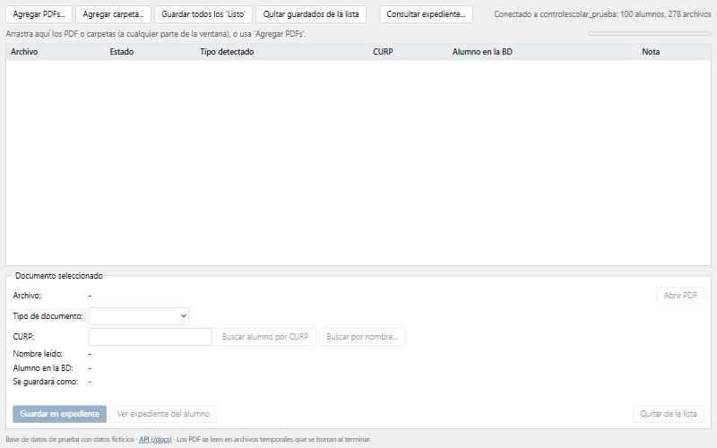
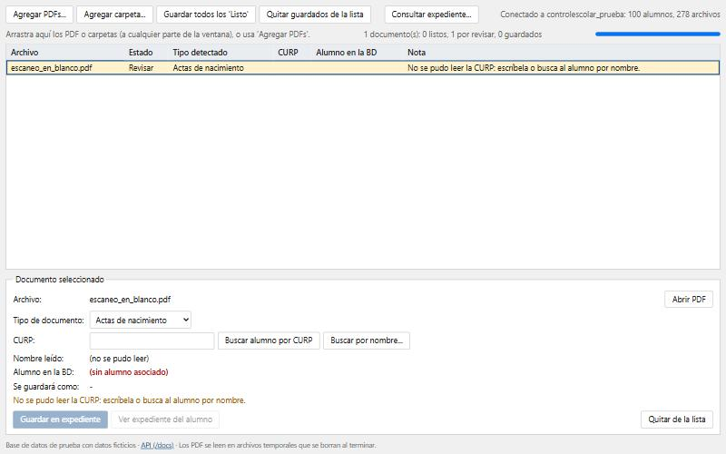

# Documento de validación y pruebas — Fase II

Sistema de Expedientes con IA (versión web en Docker). Este documento reúne las pruebas funcionales, los casos extremos
evaluados, los resultados y las conclusiones. Todas las pruebas se ejecutaron el **26 de octubre de 2026** con datos ficticios.

## 1. Objetivo

Comprobar que el sistema construido en la Fase II:

1. se construye y se ejecuta correctamente en Docker con un solo comando;
2. clasifica documentos escolares, lee la CURP, el nombre y la fecha, y los asocia al alumno correcto;
3. guarda, consulta y elimina documentos del expediente respetando las reglas del sistema;
4. responde de forma controlada ante entradas inválidas, fallas y usos indebidos.

## 2. Entorno de pruebas

| Elemento | Detalle |
|---|---|
| Equipo | Computadora de escritorio con Windows 11 Pro |
| Docker | Docker 29.8.2, Docker Compose v5.6.0 |
| Contenedor `api` | Python 3.11.17, Tesseract 5.5.0, Poppler 25.03, usuario sin privilegios (`clasificador`) |
| Contenedor `db` | MySQL 8.0 con la base de prueba (100 alumnos y 278 registros de archivos ficticios) |
| Imagen construida | `clasificador-documentos:fase2`, 867 MB |
| Modelo | TF-IDF + LinearSVC (scikit-learn 1.9.1), entrenado con más de 4,000 documentos |
| Navegador | Interfaz web probada en el navegador integrado de la aplicación de escritorio |
| Datos | Solo ficticios. Las pruebas se hicieron en una copia aislada del proyecto, con la base de datos recién creada |

## 3. Estrategia y herramientas

| Tipo de prueba | Herramienta | Cantidad |
|---|---|---|
| Pruebas automáticas (funcionales y de base de datos) | `pytest` dentro del contenedor | 17 |
| Pruebas de la interfaz (flujo completo) | Navegador, con capturas de pantalla | 5 escenarios |
| Casos extremos y de seguridad | `curl` contra la API en ejecución | 34 |
| Verificación de la imagen y los contenedores | `docker compose ps`, `docker images` | — |
| Compatibilidad con la nube | `docker run` con `PORT` y sin base de datos | 1 |

## 4. Pruebas funcionales

### 4.1 Construcción de la imagen y ejecución local

Se construyó la imagen y se encendió el sistema con:

```bash
docker compose up --build -d
```

Estado de los contenedores (ambos `healthy`):

```text
SERVICE   IMAGE                           STATUS                   PORTS
api       clasificador-documentos:fase2   Up 2 minutes (healthy)   0.0.0.0:8040->8000/tcp, [::]:8040->8000/tcp
db        mysql:8.0                       Up 2 minutes (healthy)   0.0.0.0:3347->3306/tcp, [::]:3347->3306/tcp
```

Imagen construida y versiones dentro del contenedor:

```text
REPOSITORY                TAG       SIZE
clasificador-documentos   fase2     867MB
clasificador-documentos   1.1       867MB
clasificador-documentos   1.2       867MB
```

```text
Python 3.11.17
tesseract 5.5.0
pdftoppm version 25.03.0
clasificador
```

Resultado: la imagen se construye sin errores, los dos contenedores quedan saludables y el sistema responde en `http://localhost:8000`.



### 4.2 Pruebas automáticas (pytest)

Se ejecutaron con `docker compose run --rm api pytest -v`. Las pruebas que guardan archivos usan una carpeta temporal, de modo que no alteran la carpeta `expedientes/`.

| # | Prueba | Qué verifica |
|---|---|---|
| 1 | `test_salud` | El servicio responde y el modelo está cargado |
| 2 | `test_pagina_principal` | La pantalla web se sirve en `/` |
| 3 | `test_documentacion` | La documentación `/docs` y `/openapi.json` están disponibles |
| 4 | `test_constancia_curp` | Un PDF de CURP se clasifica como CURP y se leen CURP, nombre y fecha |
| 5 | `test_acta_nacimiento` | Un acta se clasifica correctamente y se leen sus datos |
| 6 | `test_rechaza_archivo_que_no_es_pdf` | Un archivo que no es PDF se rechaza |
| 7 | `test_rechaza_archivo_muy_grande` | Un archivo mayor al límite se rechaza |
| 8 | `test_pdf_danado` | Un PDF dañado produce un error controlado |
| 9 | `test_salud_con_base` | La API se conecta a la base de datos |
| 10 | `test_buscar_alumno` | Se busca por nombre y por CURP |
| 11 | `test_expediente_en_orden` | El expediente sale ordenado: CURP, secundaria, acta, demás |
| 12 | `test_clasificar_y_guardar_en_expediente` | Se guarda como `1_CURP.pdf` y no se duplica |
| 13 | `test_clasificar_sin_guardar_no_escribe` | Clasificar sin guardar no escribe nada |
| 14 | `test_tipos_y_salud_con_conteos` | `/tipos` y los conteos de `/salud` son correctos |
| 15 | `test_alumno_por_curp` | Búsqueda por CURP válida e inválida |
| 16 | `test_guardar_reemplazar_adicional_ver_y_eliminar` | Guardar, rechazar duplicado, reemplazar, adicional, abrir PDF y eliminar |
| 17 | `test_guardar_valida_entradas` | `/guardar` rechaza PDF inválido, tipo inexistente y alumno inexistente |

Salida de la ejecución:

```text
Container fase2ev-db-1 Running 
 Container fase2ev-db-1 Waiting 
 Container fase2ev-db-1 Healthy 
 Container fase2ev-api-run-606ff6e86abc Creating 
 Container fase2ev-api-run-606ff6e86abc Created 
============================= test session starts ==============================
platform linux -- Python 3.11.17, pytest-9.1.1, pluggy-1.7.0 -- /usr/local/bin/python3.11
rootdir: /app
configfile: pytest.ini
testpaths: tests
plugins: anyio-4.15.1
collecting ... collected 17 items
tests/test_api.py::test_salud PASSED                                     [  5%]
tests/test_api.py::test_pagina_principal PASSED                          [ 11%]
tests/test_api.py::test_documentacion PASSED                             [ 17%]
tests/test_api.py::test_constancia_curp PASSED                           [ 23%]
tests/test_api.py::test_acta_nacimiento PASSED                           [ 29%]
tests/test_api.py::test_rechaza_archivo_que_no_es_pdf PASSED             [ 35%]
tests/test_api.py::test_rechaza_archivo_muy_grande PASSED                [ 41%]
tests/test_api.py::test_pdf_danado PASSED                                [ 47%]
tests/test_bd.py::test_salud_con_base PASSED                             [ 52%]
tests/test_bd.py::test_buscar_alumno PASSED                              [ 58%]
tests/test_bd.py::test_expediente_en_orden PASSED                        [ 64%]
tests/test_bd.py::test_clasificar_y_guardar_en_expediente PASSED         [ 70%]
tests/test_bd.py::test_clasificar_sin_guardar_no_escribe PASSED          [ 76%]
tests/test_bd.py::test_tipos_y_salud_con_conteos PASSED                  [ 82%]
tests/test_bd.py::test_alumno_por_curp PASSED                            [ 88%]
tests/test_bd.py::test_guardar_reemplazar_adicional_ver_y_eliminar PASSED [ 94%]
tests/test_bd.py::test_guardar_valida_entradas PASSED                    [100%]
======================== 17 passed, 1 warning in 23.53s ========================
```

**Resultado: 17 de 17 pruebas aprobadas.**

### 4.3 Flujo completo desde la interfaz

Escenario: un usuario carga dos documentos ficticios de la alumna de ejemplo, los revisa, los guarda y consulta su expediente.

| Paso | Acción | Resultado esperado | Resultado obtenido |
|---|---|---|---|
| 1 | Arrastrar `constancia_curp_ficticia.pdf` y `acta_nacimiento_ficticia.pdf` | Se leen y quedan en estado «Listo» (verde) | Aprobado: tipo CURP y Actas de nacimiento, CURP `EELM060312MCHJPRA0` con dígito verificador correcto, alumna encontrada |
| 2 | Seleccionar la primera fila | El detalle muestra tipo, CURP, nombre, alumno y «Se guardará como: 1_CURP.pdf» | Aprobado |
| 3 | «Guardar todos los 'Listo'» y confirmar | Ambos pasan a «Guardado» (azul), en orden CURP y luego acta | Aprobado: `1_CURP.pdf` y `1_ACTA DE NAC.pdf` |
| 4 | «Consultar expediente», buscar a la alumna | Aparecen los 2 documentos con «PDF en carpeta: Sí» | Aprobado |
| 5 | Cargar un PDF sin texto legible | Queda en «Revisar» (amarillo) con la nota correspondiente y no se puede guardar | Aprobado: «No se pudo leer la CURP: escríbela o busca al alumno por nombre» |




### 4.4 Compatibilidad con la nube

Se ejecutó la imagen como lo haría una plataforma en la nube (puerto por variable y sin base de datos):

```bash
docker run -d --name prueba-nube -p 8050:8080 -e PORT=8080 clasificador-documentos:fase2
```

| Comprobación | Resultado |
|---|---|
| Estado del contenedor | `healthy` |
| `GET /salud` | `estado: ok`, `modelo_cargado: true`, `base_datos: desactivada` |
| `POST /clasificar` con un acta de ejemplo | Clasifica y lee la CURP en 2.8 s |
| Página principal | HTTP 200 |
| Operaciones que requieren base de datos | 503 con mensaje claro |

Resultado: aprobado. El despliegue real en una plataforma de nube está **documentado** en el Manual de despliegue, pero **no se ejecutó** en esta fase.

### 4.5 Integración (API y endpoints)

La evidencia de cada endpoint con peticiones y respuestas reales está en `docs/EVIDENCIA_INTEGRACION.md` (y en la documentación interactiva `/docs`).


## 5. Casos extremos evaluados

Se ejecutaron 34 casos contra el sistema en funcionamiento. La columna «Resultado» indica si el comportamiento coincidió con lo esperado.

| ID | Caso | Resultado esperado | Resultado obtenido | Resultado |
|---|---|---|---|---|
| CE-01 | Archivo de texto renombrado a .pdf (`POST /clasificar`) | Rechazo 415 | 415: «El archivo no es un PDF valido.» | Aprobado |
| CE-02 | Archivo vacío (0 bytes) | Rechazo 415 | 415: «El archivo no es un PDF valido.» | Aprobado |
| CE-03 | PDF de 16 MB (límite 15 MB) | Rechazo 413 | 413: «El archivo supera el limite de 15 MB.» | Aprobado |
| CE-04 | PDF dañado (cabecera válida, contenido basura) | Error controlado 422 | 422: «No se pudo leer el PDF (puede estar danado o protegido con contrasena).» | Aprobado |
| CE-05 | Petición sin archivo | 422 | 422: campo `archivo` requerido | Aprobado |
| CE-06 | PDF válido pero en blanco (sin texto) | Responde sin caerse y sin inventar CURP | 200: CURP vacía, sin alumno asociado (en la interfaz queda «Revisar» y no se puede guardar). Ver H-1 | Aprobado |
| CE-07 | Nombre de archivo malicioso `../../etc/passwd.pdf` | Usa solo el nombre base | 200: `archivo: passwd.pdf` (se descartó la ruta); no se escribió nada fuera de la carpeta | Aprobado |
| CE-08 | Inyección SQL: `q=' OR '1'='1` | Sin resultados (consulta parametrizada) | 200: `[]` | Aprobado |
| CE-09 | Inyección SQL: `q='; DROP TABLE alumnos;--` | Sin resultados y tabla intacta | 200: `[]` | Aprobado |
| CE-10 | Verificar la base tras los intentos de inyección | 100 alumnos | 100 alumnos y 278 archivos: intacta | Aprobado |
| CE-11 | Búsqueda de 1 carácter | 422 (mínimo 2) | 422: «String should have at least 2 characters» | Aprobado |
| CE-12 | Búsqueda de 5,000 caracteres | Responde sin error de servidor | 200: `[]` | Aprobado |
| CE-13 | CURP con formato inválido (`/alumnos/por-curp/XXXX`) | 422 | 422: «La CURP debe tener 18 caracteres con el formato oficial.» | Aprobado |
| CE-14 | CURP válida que no existe en la base | Lista vacía | 200: `[]` | Aprobado |
| CE-15 | Expediente de alumno inexistente (id 999999) | Lista vacía | 200: `[]` | Aprobado |
| CE-16 | Identificador no numérico (`/alumnos/abc/expediente`) | 422 | 422: «Input should be a valid integer» | Aprobado |
| CE-17 | Eliminar un documento inexistente | 404 | 404: «El documento no existe en el expediente de ese alumno.» | Aprobado |
| CE-18 | Abrir el PDF de un documento inexistente | 404 | 404: «El documento no existe en el expediente de ese alumno.» | Aprobado |
| CE-19 | Guardar con un alumno inexistente | 404 | 404: «No existe ese alumno.» | Aprobado |
| CE-20 | Guardar con un tipo de documento inválido | 422 | 422: «Tipo de documento no valido: OTRA» | Aprobado |
| CE-21 | Guardar con un modo inválido | 422 | 422: «modo debe ser nuevo, reemplazar o adicional.» | Aprobado |
| CE-22 | Guardar un archivo que no es PDF | 415 | 415: «El archivo no es un PDF valido.» | Aprobado |
| CE-23 | Guardar la CURP de la alumna 1 (primera vez) | 200 y archivo `1_CURP.pdf` | 200: `guardado_como: 1_CURP.pdf` | Aprobado |
| CE-24 | Guardar otra vez el mismo tipo en modo nuevo | 409, sin duplicar | 409: «El alumno ya tiene un documento de este tipo: elige reemplazar o adicional.» | Aprobado |
| CE-25 | Reemplazar un documento que no es del alumno | 422 | 422: «El documento a reemplazar no existe en el expediente del alumno.» | Aprobado |
| CE-26 | Guardar como adicional (segundo documento del mismo tipo) | 200 con nombre distinto | 200: `guardado_como: 1_CURP_2.pdf` | Aprobado |
| CE-27 | Abrir el PDF guardado | 200 y `application/pdf` | 200: `content-type: application/pdf`, `content-disposition: inline` | Aprobado |
| CE-28 | 4 PDFs enviados al mismo tiempo (límite 2 a la vez) | Los 4 responden 200, en cola | 200, 200, 200, 200 en 6 s (un solo PDF tarda 3 s: se procesan de 2 en 2) | Aprobado |
| CE-29 | 1 PDF solo (referencia de tiempo) | — | 3 s | Aprobado |
| CE-30 | Reiniciar los contenedores y revisar los documentos guardados | Siguen los 2 documentos | 2 registros en la base y 2 PDFs en `expedientes/archivos` | Aprobado |
| CE-31 | Base de datos apagada: `GET /salud` | Responde e indica el error | 200: `base_datos: "error"` | Aprobado |
| CE-32 | Base de datos apagada: buscar alumnos | 503 con mensaje claro | 503: «No se pudo conectar a MySQL (db)...» | Aprobado |
| CE-33 | Base de datos apagada: clasificar un PDF | Sigue clasificando | 200: tipo CURP y CURP leída; sin alumno asociado | Aprobado |
| CE-34 | Base de datos encendida de nuevo: `GET /salud` | Se recupera sola | 200: `base_datos: "conectada"` | Aprobado |

### 5.1 Resumen de los casos extremos

| Categoría | Casos | Aprobados |
|---|---|---|
| Entradas inválidas (archivos) | 7 | 7 |
| Seguridad en búsquedas (inyección SQL, entradas enormes) | 7 | 7 |
| Identificadores inexistentes o mal formados | 4 | 4 |
| Reglas de guardado | 9 | 9 |
| Concurrencia | 2 | 2 |
| Persistencia | 1 | 1 |
| Falla y recuperación de la base de datos | 4 | 4 |
| **Total** | **34** | **34** |

## 6. Hallazgos y limitaciones

| # | Hallazgo | Impacto | Mitigación actual / mejora propuesta |
|---|---|---|---|
| H-1 | Un PDF en blanco (sin texto) se clasifica como «Actas de nacimiento», porque el modelo siempre elige una de sus 6 clases | Bajo: sin CURP no se asocia a ningún alumno, queda en «Revisar» y no se puede guardar | Agregar una clase «otro / ilegible» o un umbral de confianza (el clasificador actual no entrega probabilidad) |
| H-2 | La aplicación no tiene contraseña de acceso | Alto si se publica con datos reales | Se usan solo datos ficticios; autenticación y HTTPS quedan para la Fase III |
| H-3 | No se probó un PDF protegido con contraseña ni documentos de cientos de páginas | Bajo | El código responde 422 a cualquier error de lectura; queda como prueba pendiente |
| H-4 | El despliegue en una nube real está documentado pero no ejecutado | Medio | Se validó la compatibilidad de la imagen (sección 4.4); requiere cuenta con facturación |
| H-5 | Las pruebas de exactitud del modelo con documentos reales dependen del conjunto de entrenamiento | Medio | Según el cuaderno de entrenamiento, el modelo alcanza cerca de 0.97 de exactitud en un conjunto de prueba reservado de 835 documentos; el valor de 0.99 con los 4,173 documentos incluye datos de entrenamiento y es optimista |
| H-6 | Solo se probó con 2 documentos ficticios de ejemplo en las pruebas de la interfaz | Medio | Los documentos reales no se incluyen en el repositorio por privacidad |

## 7. Resultados y conclusiones

### Resultados

| Criterio | Resultado |
|---|---|
| Imagen Docker construida y contenedores saludables | Cumple |
| Ejecución local con un solo comando | Cumple |
| Pruebas automáticas | 17 de 17 aprobadas |
| Flujo completo desde la interfaz | 5 de 5 escenarios aprobados |
| Casos extremos y de seguridad | 34 de 34 con comportamiento controlado |
| Compatibilidad con plataformas de nube (puerto por variable, sin base de datos) | Cumple |
| Despliegue en nube real | Documentado, no ejecutado |

### Conclusiones

1. El sistema **cumple los objetivos de la Fase II**: se construye y ejecuta con Docker con un solo comando, clasifica documentos, lee CURP, nombre y fecha, y gestiona el expediente (guardar, reemplazar, adicional, consultar, abrir y eliminar con papelera).
2. El comportamiento ante **entradas inválidas y fallas es controlado**: se rechazan archivos que no son PDF, vacíos, demasiado grandes o dañados con códigos HTTP y mensajes claros; las consultas SQL usan parámetros y resistieron los intentos de inyección; el sistema sigue clasificando cuando la base de datos se apaga y se recupera solo al volver.
3. Los datos **persisten** al reiniciar los contenedores gracias al volumen de MySQL y a la carpeta `expedientes/`.
4. La **concurrencia** está acotada: al enviar 4 documentos al mismo tiempo se procesan de 2 en 2 y todos reciben respuesta, lo que protege al servidor del exceso de carga del OCR.
5. Las **limitaciones principales** (sin autenticación, sin clase «ilegible» en el modelo, despliegue en nube no ejecutado) están identificadas y quedan como trabajo de la **Fase III**.

## 8. Cómo repetir las pruebas

```bash
docker compose up --build -d               # construir y encender
docker compose ps                          # ambos contenedores "healthy"
docker compose run --rm api pytest -v      # 17 pruebas automáticas
```

Los casos extremos se ejecutan con `curl` contra `http://localhost:8000`; los comandos exactos aparecen en la columna «Caso» de la sección 5 y en `docs/EVIDENCIA_INTEGRACION.md`.
